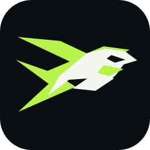

<div align="center">



# ZERO HAWK

### Find the right businesses. Understand the opportunity. Make every outreach decision count.

**A local-first prospecting and outreach command centre — built to keep your data on your machine and every important action under your control.**

[Quick start](#-quick-start) · [What it does](#-what-zero-hawk-does) · [Safety](#-human-control-first) · [Roadmap](#-honest-status)


</div>

---

## The idea

Zero Hawk helps you move from a target market to an organised, evidence-backed prospect list without handing your entire workflow to a black box.

It can discover businesses from OpenStreetMap, research public websites, record buying signals, organise companies and contacts, prepare AI-assisted drafts, and keep approved outreach in a review-first workflow.

It runs on your own computer. Your local database stays local. Optional AI providers and messaging services are only used when you configure them.

> **Built around one rule: you stay in control.** No campaign is silently launched by the background profiling loop. Email sending requires an explicitly approved draft and the configured checks.

## What Zero Hawk does

| Stage | What happens | Where to look |
| --- | --- | --- |
| **Discover** | Find businesses from free OpenStreetMap / Overpass data around a place you choose | Discover |
| **Research** | Read public business websites and collect source-linked observations | Companies |
| **Spot signals** | Score configurable website indicators such as booking, ordering, HTTPS and hiring pages | Signals |
| **Organise** | Keep companies, contacts, campaigns, notes and activity in a local SQLite database | Companies · Contacts · Campaigns |
| **Train** | Read your own website and create an editable local profile for your product, offer and ideal customer | Train |
| **Agent** | Ask Scout to analyse saved prospect evidence and prepare a reviewable outreach plan | Scout |
| **Draft** | Use a configured local or connected AI provider to prepare outreach drafts | Outbox |
| **Review** | Inspect drafts and explicitly approve or reject them | Outbox |
| **Send** | Send an approved, eligible email through configured SMTP | Outbox |
| **Connect** | Expose a small set of local tools to compatible MCP clients | MCP |

### A look at the workflow

```text
  YOUR PRODUCT / OFFER
          |
          v
  TRAIN YOUR WORKSPACE
          |
          v
  DISCOVER BUSINESSES  ---->  COMPANY REGISTER
          |                         |
          v                         v
  RESEARCH PUBLIC SITES      CONTACTS & CAMPAIGNS
          |                         |
          v                         v
  BUYING-SIGNAL EVIDENCE      AI-ASSISTED DRAFTS
                                    |
                                    v
                              HUMAN REVIEW
                                    |
                           approve explicitly
                                    |
                                    v
                              SMTP SEND
```

Zero Hawk can be used one stage at a time. You do not need to connect an email account to use discovery, research, local records, signals or exports.

## ✨ Highlights

- **Local-first:** FastAPI dashboard with a local SQLite database.
- **Free discovery source:** OpenStreetMap / Overpass and Nominatim; no paid API key required for the default source.
- **Evidence-aware research:** Public-site observations retain source URLs and confidence context.
- **Configurable signals:** Deterministic website checks; no AI call is required for signal profiling.
- **Flexible AI:** Ollama, Claude Code CLI, Codex CLI, and optional hosted API-compatible providers.
- **Scout agent workspace:** run an AI research report over saved companies, recorded signals, contact records and your trained offer; it prepares a three-step outreach plan but never sends it.
- **Free warmup choices:** launch Warmerly Free, TrulyInbox Free or Warmup Inbox Freemium; provider-side warmup is managed on each provider unless an eligible API integration is configured.
- **Human-reviewed email:** SMTP sending is gated by explicit approval, recipient status, suppression checks and an HTTPS unsubscribe base URL.
- **Portable data:** CSV import and export for company and contact records.
- **Compatible tools:** Optional MCP server for supported local AI clients.
- **Windows-friendly:** One-click `run.bat` setup for Windows 10/11.

## 🦅 Quick start

### Requirements

- Windows 10 or 11
- Python **3.11 or newer**
- Git for Windows
- Internet connection for package installation and online discovery

No API key is needed to install or open the dashboard. Ollama or another AI provider is optional.

### Step 1 — Download ZERO HAWK

Once Python and Git are installed, open **Command Prompt** (CMD) and run:

```cmd
cd %USERPROFILE%
git clone https://github.com/Nex0raLabs/zero-hawk.git
cd zero-hawk
```

### Step 2 — Install ZERO HAWK

Run these commands in the same CMD window:

```cmd
python -m venv .venv
.venv\\Scripts\\activate
python -m pip install --upgrade pip
pip install -e .
```

This creates an isolated Python environment and installs ZERO HAWK with its command-line launcher.

### Step 3 — Open your dashboard

Run:

```cmd
zero-hawk dashboard
```

ZERO HAWK starts locally and prints a private dashboard link in CMD. Open that link in your browser. Keep the full private link secret. Press **Ctrl+C** in CMD to stop the dashboard.

The default dashboard address is `http://127.0.0.1:5555`. The private token is included in the link printed by the application.

### Optional — One-click launch

After the first installation, you can also run `run.bat` from the project folder. It checks the environment, installs the optional MCP extra and starts the dashboard.

If Windows does not recognize `python`, install Python 3.11+ from [python.org](https://www.python.org/downloads/windows/), enable **Add Python to PATH**, close CMD, and open it again. Install [Git for Windows](https://git-scm.com/download/win) if `git` is not recognized.

> The executable command is `zero-hawk dashboard` (not `sellbird dashboard`): ZERO HAWK is its own application and command.

## First five minutes

1. Open **Train** and enter your business website to create an editable local product profile.
2. Review the generated profile. Extraction is heuristic; correct anything that is wrong.
3. Open **Signals** and choose the website indicators that matter to your offer.
4. Open **Discover**, enter a city or place, choose a business category and search.
5. Open a saved company to inspect its public website and evidence before deciding whether it is a suitable prospect.

You can add companies manually and import CSV records too. Discovery results depend on OpenStreetMap coverage and are not a complete business directory.

## 🧠 Choose an AI provider

AI is optional. The core local workspace does not require a paid model API.

### Ollama — local model

1. Install [Ollama](https://ollama.com/).
2. Open CMD and download a model, for example:

```cmd
ollama pull llama3.2
```

3. In Zero Hawk **Settings**, select Ollama, or set these values in your private `.env`:

```env
ZERO_HAWK_AI_PROVIDER=ollama
ZERO_HAWK_AI_MODEL=llama3.2
ZERO_HAWK_AI_BASE_URL=http://localhost:11434/v1
```

The model runs on your computer. Performance depends on your hardware and the model you download.

### Claude Code CLI or Codex CLI

Choose a CLI provider in Settings if its command-line tool is already installed and signed in on your computer. Use **Test connection** to check the actual connection. A ChatGPT or Claude browser tab cannot directly call a server running on your PC; use a compatible local agent/MCP client instead.

### Optional hosted providers

Anthropic and OpenAI-compatible endpoints can be configured with their respective API keys. Provider usage may incur charges. Never paste API keys into GitHub, screenshots, issues or chat messages.

## 📱 Connect WhatsApp

Zero Hawk now includes an official WhatsApp Business Cloud API integration and keeps the optional Baileys sidecar for local experimentation.

### Official Cloud API setup

1. Create or select a Meta developer app and add the WhatsApp product.
2. In the WhatsApp API setup, obtain your access token, Phone Number ID and WhatsApp Business Account details. Keep the token private.
3. Add these values to your local, ignored `.env` file (not GitHub):
   ```env
   ZERO_HAWK_WA_CLOUD_TOKEN=your_access_token
   ZERO_HAWK_WA_PHONE_NUMBER_ID=your_phone_number_id
   ZERO_HAWK_WA_VERIFY_TOKEN=your_private_webhook_verify_token
   ZERO_HAWK_WA_APP_SECRET=your_meta_app_secret
   ZERO_HAWK_WA_API_VERSION=v27.0
   ZERO_HAWK_WA_DAILY_SEND_LIMIT=25
   ```
4. Restart Zero Hawk and open **WhatsApp** in the dashboard. Use **Test Cloud API connection**.
5. Configure the Meta webhook callback as `https://YOUR-PUBLIC-HTTPS-HOST/webhooks/whatsapp`, enter the same verify token, and subscribe to the WhatsApp `messages` field.
6. The webhook must reach the running Zero Hawk process over public HTTPS. For a local Windows installation, use a secure HTTPS tunnel or reverse proxy and keep the dashboard itself private.

The dashboard stores inbound messages, delivery/read status events, conversation notes and status. AI can analyse a thread and generate an editable reply draft. Open a WhatsApp thread to review it, ask the configured AI provider to analyse the conversation or generate an editable reply draft, and add private notes/statuses. Sending requires the explicit approval checkbox, obeys the global sending pause and a configurable daily cap, and is never triggered by Autopilot.

**Important limitations:** Cloud API free-form replies are subject to WhatsApp's customer-service window. Approved template messages can be sent outside that window when the template is approved by Meta and the supplied language/parameters match. Media messages are recorded as message-type placeholders rather than downloaded into the local database. Previously delivered messages cannot be freely edited or deleted by this dashboard. Meta may charge for business messaging according to its current pricing and message category. Use the official Meta documentation for current eligibility, onboarding and pricing.

### Optional local WhatsApp Web sidecar

The existing Baileys sidecar remains available for personal/local testing. It is unofficial and may cause account restrictions. It is not the recommended production connection. Do not use it for bulk unsolicited outreach.

## 🔌 Connect a compatible AI client (MCP)

Zero Hawk includes an optional local MCP server. Install the extra:

```cmd
python -m pip install -e ".[mcp]"
```

A compatible desktop/agent client can launch the server using the Python executable inside this checkout. Example configuration:

```json
{
  "mcpServers": {
    "zero-hawk": {
      "command": "C:\\Users\\YOUR_USER\\zero-hawk\\.venv\\Scripts\\python.exe",
      "args": ["-m", "openprospect.mcp_server"],
      "cwd": "C:\\Users\\YOUR_USER\\zero-hawk"
    }
  }
}
```

Replace `YOUR_USER` with your Windows account folder. The MCP agent tools can search and discover prospects, read saved company/contact data, research public websites and signals, read your product profile, check SMTP/IMAP and DNS readiness, sync unread IMAP messages, create campaign containers, prepare personalised drafts, and read activity. The agent cannot approve or send messages, change safety controls, or start Autopilot. See [AGENT_GUIDE.md](AGENT_GUIDE.md) for the full setup and tool list.

## 🛡️ Human control first

- Autopilot runs a configurable 15-minute-minimum heartbeat to profile saved companies and record signals; it does **not** run an autonomous send campaign. Its ON/OFF state and interval are saved locally.
- Email delivery is optional and requires SMTP configuration.
- A draft must be explicitly approved before it can be sent.
- The send path checks the app's verified-recipient status, suppression list and HTTPS unsubscribe configuration.
- A verification label is a heuristic status, not proof that a person owns or reads an inbox.
- Public contact details do not automatically mean someone has consented to marketing.
- WhatsApp Cloud API has a code-level integration for text sending, inbound webhooks, delivery/read status, conversation notes and AI analysis; live Meta onboarding and end-to-end tests still require the user's Meta credentials and a public HTTPS webhook. The optional Baileys sidecar is unofficial.

Use a test mailbox and contacts you control before any real sending. Follow the marketing, privacy and anti-spam laws that apply to you and your recipients.

## Commands

The primary command is now `zero-hawk`. The internal Python package keeps its legacy import path for compatibility. Environment settings now use the `ZERO_HAWK_*` prefix; existing `OPENPROSPECT_*` variables continue to work as fallbacks.

```cmd
zero-hawk dashboard
zero-hawk status
zero-hawk companies
zero-hawk train https://your-company.com
zero-hawk run
zero-hawk mcp
```

## Honest status

Zero Hawk is an active local-first alpha, not a finished autonomous sales platform. The following areas are present only in limited form or still need live integration work:

| Area | Current state |
| --- | --- |
| Dashboard, local records, CSV | Implemented; needs your clean-machine acceptance test |
| OpenStreetMap discovery | Implemented; coverage and results vary by area |
| Website signals and training | Implemented with heuristic extraction; review the output |
| AI provider connections | Provider options exist; test with your own installed provider |
| SMTP sending | Implemented with manual approval gates; live mailbox testing required |
| IMAP | Basic unread-message import; not a complete reply-management system |
| WhatsApp | Cloud API code path implemented; Meta credentials, public webhook and live end-to-end tests required |
| Decision-maker enrichment | No complete provider-backed enrichment pipeline |
| Campaign automation | No full discovery-to-send autonomous pipeline |
| Production deployment | Not supported as a public multi-user service; dashboard is loopback-only |

See [REPORT.md](REPORT.md) for the detailed evidence-based QA audit, known blockers and release limitations. Do not interpret a feature's presence in the interface as proof of a complete end-to-end integration.

## Troubleshooting

**'git' is not recognized**  
Install [Git for Windows](https://git-scm.com/download/win), reopen CMD and retry.

**'py' is not recognized**  
Install Python 3.11+ and enable the Python Launcher / PATH option.

**The dashboard command is not recognized**  
Activate the virtual environment from the project folder, then run `python -m pip install -e ".[dev,mcp]"` again.

**Port 5555 is already in use**  
Close the other Zero Hawk process first. If you intentionally need another local port, set `ZERO_HAWK_PORT` in `.env` and restart.

**Discovery returns few businesses**  
OpenStreetMap is community-maintained. Try a broader place/category or add companies manually; results are not guaranteed to be complete.

## Project files and privacy

- `.env` — private provider and mailbox settings; never commit it.
- `.venv/` — local Python environment.
- Local database and app state — stored in your user data folder.
- `REPORT.md` — QA evidence and known limitations.

Do not commit real prospect data, mailbox credentials, WhatsApp session files, API keys or dashboard token files.

## Contributing

Issues and pull requests are welcome. Include reproducible steps and tests for code changes. Never submit real personal data or secrets.

## License

Zero Hawk is licensed under the **GNU Affero General Public License v3.0 (AGPL-3.0)**. See [LICENSE](LICENSE).
